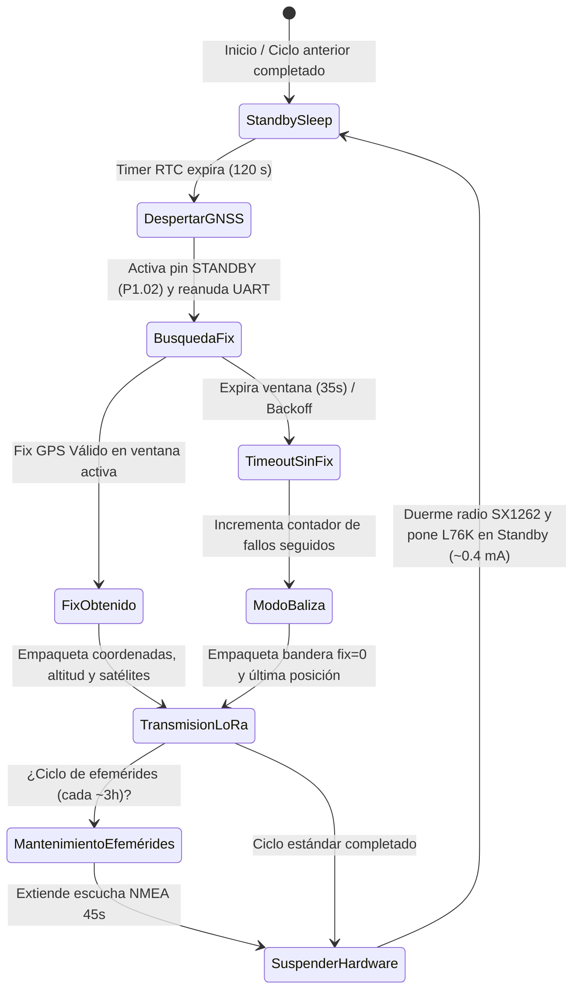
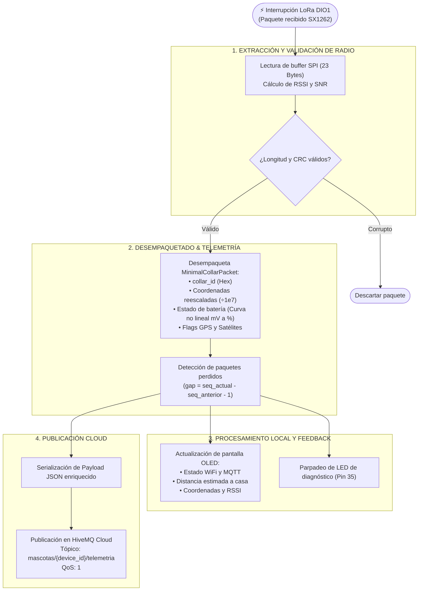
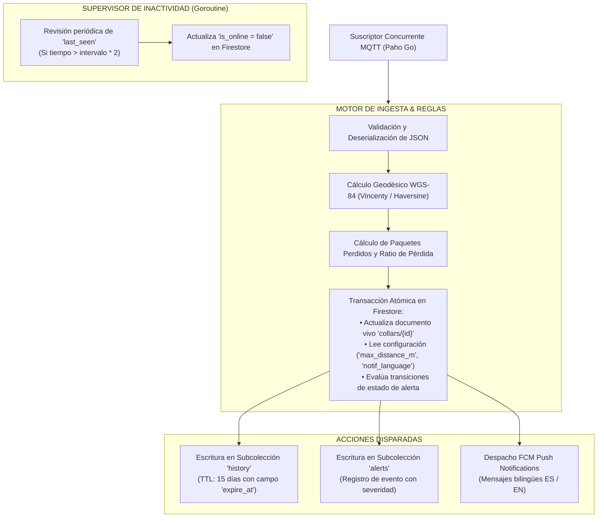

# Michi Link

[](https://flutter.dev)
[](https://dart.dev)
[](https://go.dev)
[](https://www.espressif.com/)
[](https://www.semtech.com/lora)
[](https://firebase.google.com/)
[](LICENSE)

**Michi Link** es un ecosistema IoT integral diseñado para la localización satelital continua, monitoreo de telemetría y seguridad de mascotas (específicamente gatos) en entornos suburbanos y urbanos. El sistema combina radioenlace de largo alcance **LoRa P2P (915 MHz)** de ultra bajo consumo en el collar del animal, una estación base retransmisora **ESP32-S3** conectada vía WiFi, un broker de mensajería **MQTT con cifrado TLS**, un servicio de ingesta concurrente en **Go** alojado en Google Cloud Platform (GCP) con motor geodésico WGS-84 y disparador de notificaciones push (**FCM**), y una aplicación cliente multiplataforma desarrollada en **Flutter** con arquitectura Feature-First.

---

## 📑 Tabla de Contenidos

1. [Arquitectura Global del Sistema](#-arquitectura-global-del-sistema)
2. [Inicio Rápido (Quick Start)](#-inicio-rápido-quick-start)
3. [Tabla Unificada de Comandos](#-tabla-unificada-de-comandos)
4. [Componentes del Ecosistema](#-componentes-del-ecosistema)
   - [Collar IoT (Heltec T114 - nRF52840 + SX1262 + L76K)](#1-collar-iot-heltec-t114)
   - [Estación Base (Heltec WiFi LoRa 32 V3 - ESP32-S3)](#2-estación-base-heltec-wifi-lora-32-v3)
   - [Protocolo de Comunicación y Radioenlace](#3-protocolo-de-comunicación-y-radioenlace)
   - [Backend de Ingesta y Procesamiento en Go](#4-backend-de-ingesta-y-procesamiento-en-go)
   - [Persistencia y Modelo de Datos en Cloud Firestore](#5-persistencia-y-modelo-de-datos-en-cloud-firestore)
   - [Aplicación Móvil en Flutter](#6-aplicación-móvil-en-flutter)
5. [Architecture Decision Records (ADRs)](#-architecture-decision-records-adrs)
   - [ADR-001: Radioenlace LoRa P2P vs. Red LoRaWAN](#adr-001-radioenlace-lora-p2p-vs-red-lorawan)
   - [ADR-002: Formato de Paquete Binario Compacto en el Aire (23 Bytes)](#adr-002-formato-de-paquete-binario-compacto-en-el-aire-23-bytes)
   - [ADR-003: Backend Ingestor y Motor de Eventos en Go sobre GCP e2-micro](#adr-003-backend-ingestor-y-motor-de-eventos-en-go-sobre-gcp-e2-micro)
   - [ADR-004: Modelo Híbrido de Persistencia en Firestore con TTL de 15 Días](#adr-004-modelo-híbrido-de-persistencia-en-firestore-con-ttl-de-15-días)
   - [ADR-005: Arquitectura Feature-First con BLoC/Cubit y GetIt en Flutter](#adr-005-arquitectura-feature-first-con-bloccubit-y-getit-en-flutter)
   - [ADR-006: Geodesia WGS-84 en Servidor y Notificaciones Push Multilingües con FCM](#adr-006-geodesia-wgs-84-en-servidor-y-notificaciones-push-multilingües-con-fcm)
6. [Estructura del Directorio del Proyecto](#-estructura-del-directorio-del-proyecto)
7. [Pruebas y Calidad de Código](#-pruebas-y-calidad-de-código)
8. [Licencia](#-licencia)

---

## 🏛️ Arquitectura Global del Sistema

```mermaid
flowchart TB
    %% CAPA FÍSICA / IOT
    subgraph IOT ["📡 1. CAPA IOT / HARDWARE"]
        direction LR
        subgraph COLLAR ["COLLAR T114 (Gato)"]
            direction TB
            C1["GNSS Quectel L76K\n(Lectura NMEA: Lat, Lon, Alt)"]
            C2["MCU Nordic nRF52840\n• Empaqueta Struct 23B\n• Gestión de energía y backoff"]
            C3["Semtech SX1262 LoRa\n(TX 915 MHz, SF7, +22 dBm)"]
            C1 --> C2 --> C3
        end

        subgraph BASE ["ESTACIÓN BASE (Hogar)"]
            direction TB
            B1["Semtech SX1262 LoRa\n(RX 915 MHz, Interrupción DIO1)"]
            B2["ESP32-S3 Dual Core\n• Desempaquetado binario\n• Enriquecimiento (NTP, RSSI, SNR)\n• Pantalla OLED SSD1306 128x64"]
            B3["Stack WiFi 802.11 b/g/n\n(Cliente TLS Seguro)"]
            B1 --> B2 --> B3
        end

        C3 -->|"Radioenlace LoRa P2P\n(~200 m - 1 km urbano)"| B1
    end

    %% BROKER MQTT
    subgraph BROKER_ZONE ["☁️ 2. MENSAJERÍA CLOUD"]
        BROKER["HiveMQ Cloud (Broker MQTT)\n• Puerto: 8883 (TLS/SSL)\n• Tópico Telemetría: mascotas/+/telemetria\n• Tópico Estado: mascotas/+/status"]
    end

    %% BACKEND GCP
    subgraph BACKEND ["⚙️ 3. INGESTA & PROCESAMIENTO (GCP e2-micro)"]
        direction TB
        BE_GO["Servicio Ingestor Continuo (Go)\n• Suscriptor concurrente Paho MQTT\n• Motor Geodésico WGS-84 (Vincenty/Haversine)\n• Geocercas dinámicas y detección de anomalías\n• Watchdog de desconexión / presencia"]
    end

    %% PERSISTENCIA Y NOTIFICACIONES
    subgraph GOOGLE_SERVICES ["🔥 4. PERSISTENCIA & NOTIFICACIONES"]
        direction LR
        DB[("Cloud Firestore\n• Doc en vivo: collars/{id}\n• Subcolección: history (TTL 15d)\n• Subcolección: alerts (TTL 15d)")]
        FCM["Firebase Cloud Messaging (FCM)\nNotificaciones Push en Español/Inglés"]
    end

    %% CLIENTES FINALES
    subgraph CLIENTES ["👥 5. CLIENTES FINALES (Flutter Mobile)"]
        direction LR
        CLI_APP["📱 App Móvil Flutter\n• Google Maps & Avatares por Raza\n• Transmisión reactiva vía Firestore Streams\n• Telemetría de enlace, geocerca y batería\n• Centro de alertas y rutas históricas"]
    end

    %% CONEXIONES ENTRE CAPAS
    B3 -->|"Publica JSON vía MQTT sobre TLS"| BROKER
    BROKER -->|"Consumo continuo de eventos"| BE_GO

    BE_GO -->|"Transacciones atómicas y TTL"| DB
    BE_GO -->|"Despacho de alertas críticas"| FCM

    DB -.->|"Stream reactivo en tiempo real"| CLI_APP
    FCM -->|"Push Notifications al dispositivo"| CLI_APP
```



---

## 🚀 Inicio Rápido (Quick Start)

### 1. Requisitos Previos

- **Firmware**: [Arduino IDE 2.x](https://www.arduino.cc/en/software) o [PlatformIO](https://platformio.org/).
  - Soporte de placas Heltec ESP32 (`v3.0.0+`) y Nordic nRF52 (`Adafruit nRF52 Board Support`).
  - Librerías: `RadioLib` (v6.6+), `TinyGPSPlus`, `PubSubClient`, `ArduinoJson` (v7+), `Adafruit_SSD1306`, `Adafruit_GFX`.
- **Backend**: [Go SDK](https://go.dev/dl/) versión `>= 1.22.0`.
  - Google Cloud CLI (`gcloud`) autenticado con Application Default Credentials (ADC).
- **Móvil**: [Flutter SDK](https://flutter.dev/docs/get-started/install) `>= 3.47.0` y [Dart SDK](https://dart.dev/get-dart) `>= 3.12.0 < 4.0.0`.
  - Android Studio o Xcode configurado.
  - Llaves válidas para Google Maps SDK y archivo `google-services.json` (Android) / `GoogleService-Info.plist` (iOS).

---

### 2. Puesta en Marcha por Componente

#### A. Firmware del Collar (Heltec T114)
1. Conectar la placa Heltec T114 vía USB-C.
2. Abrir el sketch [`firmware/collar_t114/collar_t114.ino`](file:///Users/piero.morales/Documents/StudioProjects/Michi_Link/firmware/collar_t114/collar_t114.ino).
3. Verificar la configuración del nodo en [`firmware/collar_t114/config.h`](file:///Users/piero.morales/Documents/StudioProjects/Michi_Link/firmware/collar_t114/config.h) (`COLLAR_ID`, frecuencia 915 MHz).
4. Seleccionar la placa objetivo y compilar/subir el binario.

#### B. Firmware de la Estación Base (ESP32-S3)
1. Conectar la placa Heltec WiFi LoRa 32 V3 vía USB-C.
2. Abrir [`firmware/base_esp32/base_esp32.ino`](file:///Users/piero.morales/Documents/StudioProjects/Michi_Link/firmware/base_esp32/base_esp32.ino).
3. Configurar las credenciales de red WiFi y del broker HiveMQ Cloud (`WIFI_SSID`, `WIFI_PASSWORD`, `MQTT_BROKER`, `MQTT_USER`, `MQTT_PASS`).
4. Flashear el firmware. La pantalla OLED indicará el estado de conexión WiFi, MQTT y la recepción de paquetes LoRa.

#### C. Backend Suscriptor (Go)
1. Navegar al directorio del backend:
   ```bash
   cd backend_suscriptor
   ```
2. Crear y configurar el archivo de variables de entorno `.env`:
   ```ini
   GCP_PROJECT_ID=tu-proyecto-firebase
   HIVEMQ_BROKER=ssl://tu-broker.s1.eu.hivemq.cloud:8883
   HIVEMQ_USER=tu-usuario-mqtt
   HIVEMQ_PASS=tu-password-mqtt
   COLLAR_INTERVAL_SEC=120
   ```
3. Descargar dependencias y ejecutar en modo local:
   ```bash
   go mod tidy
   go run ./cmd/ingester
   ```
4. Para ejecutar el simulador de telemetría (pruebas locales sin hardware):
   ```bash
   go run ./cmd/simulator
   ```

#### D. Aplicación Móvil (Flutter)
1. Navegar al directorio de la aplicación:
   ```bash
   cd michi_link_mobile
   ```
2. Descargar paquetes y regenerar internacionalización:
   ```bash
   flutter pub get
   flutter gen-l10n
   ```
3. Ejecutar en emulador o dispositivo físico:
   ```bash
   flutter run
   ```

---

## 🛠️ Tabla Unificada de Comandos

| Entorno / Módulo | Comando | Descripción |
| :--- | :--- | :--- |
| **Backend (Go)** | `go test ./... -v` | Ejecuta la suite completa de pruebas unitarias del backend. |
| **Backend (Go)** | `go test ./cmd/ingester -cover` | Mide la cobertura de código del servicio de ingesta y geocercas. |
| **Backend (Go)** | `go build -ldflags="-s -w" -o backend_suscriptor ./cmd/ingester` | Compila el binario de producción optimizado para Linux/GCP. |
| **Backend (Go)** | `./deploy.sh` | Despliegue automatizado con systemd en la instancia GCP Compute Engine. |
| **Backend (Go)** | `go run ./cmd/simulator` | Inicia el generador sintético de telemetría y pruebas de carga MQTT. |
| **Mobile (Flutter)** | `flutter pub get` | Resuelve y descarga las dependencias del proyecto móvil. |
| **Mobile (Flutter)** | `flutter gen-l10n` | Regenera las clases tipadas de localización desde archivos `.arb`. |
| **Mobile (Flutter)** | `flutter test` | Ejecuta la suite de pruebas unitarias y de widgets en Flutter. |
| **Mobile (Flutter)** | `flutter test --coverage` | Ejecuta las pruebas y genera el reporte LCOV en `coverage/lcov.info`. |
| **Mobile (Flutter)** | `flutter analyze` | Ejecuta el análisis estático de código (`very_good_analysis` y `bloc_lint`). |
| **Mobile (Flutter)** | `dart fix --apply` | Aplica correcciones automáticas de formato y linter recomendadas. |
| **Mobile (Flutter)** | `flutter run -d chrome` | Inicia la app en modo navegador web con fines de inspección de UI. |
| **Mobile (Flutter)** | `flutter build apk --release` | Genera el instalador APK optimizado para dispositivos Android. |
| **Mobile (Flutter)** | `flutter build appbundle --release` | Compila el paquete AAB para publicación en Google Play Store. |

---

## 🧩 Componentes del Ecosistema

### 1. Collar IoT (Heltec T114)

El nodo collar está basado en el microcontrolador **Nordic nRF52840** (ARM Cortex-M4 con FPU) acoplado a un transceptor **Semtech SX1262** y un receptor GNSS **Quectel L76K**.



- **Gestión Avanzada de Energía**:
  - El módulo GNSS L76K se conmuta a modo standby mediante hardware en el pin `STANDBY` (P1.02) y no por comandos NMEA que pueden ser ignorados por el chip.
  - Suspensión limpia de la UART (`gpsUartSuspend`) precargando el latch GPIO en nivel `HIGH` antes de apagar el periférico para evitar el flanco de bajada que causaría el despertar involuntario del receptor.
  - **Algoritmo de Backoff en Interiores**: Si el gato ingresa a un recinto cerrado sin cobertura satelital, el firmware detecta los fallos consecutivos y amplía el tiempo de espera hasta 60 minutos entre intentos prolongados de adquisición, evitando el agotamiento prematuro de la batería.
- **Protección de Celda LiPo**:
  - Lectura ADC calibrada en el pin `PIN_BAT_ADC` con divisor resistivo controlado por transistor (`PIN_BAT_ADC_CTL`).
  - Umbral crítico en `3350 mV`: tras 3 lecturas consecutivas por debajo de este voltaje, el collar se suspende indefinidamente para evitar daños irreversibles a la celda LiPo.

---

### 2. Estación Base (Heltec WiFi LoRa 32 V3)

La estación base se ubica fija en el hogar del usuario y está basada en el **ESP32-S3** con pantalla OLED monocromática de 0.96 pulgadas (SSD1306).



- **Curva No Lineal de Batería**: Convierte milivoltios a porcentaje empleando un algoritmo por tramos que respeta la química de descarga de las baterías de iones de litio (desde 4160 mV para el 100% hasta 3000 mV para corte).
- **Enriquecimiento de Métricas**: Calcula la brecha de paquetes perdidos (`packets_lost_gap`) protegiendo el desbordamiento de enteros de 16 bits (`seq`).

---

### 3. Protocolo de Comunicación y Radioenlace

#### A. Paquete Binario en el Aire (23 Bytes)

Para maximizar el alcance de radio y minimizar el tiempo en el aire (*Time on Air - ToA*), el collar utiliza una estructura C++ empaquetada a nivel de byte:

```cpp
struct __attribute__((packed)) MinimalCollarPacket {
  uint64_t collar_id;  // 8 bytes: Identificador único de 16 caracteres hexadecimales
  uint16_t seq;        // 2 bytes: Contador secuencial incremental
  int32_t lat_scaled;  // 4 bytes: Latitud con 7 decimales (lat * 10,000,000)
  int32_t lon_scaled;  // 4 bytes: Longitud con 7 decimales (lon * 10,000,000)
  int16_t alt_m;       // 2 bytes: Altitud sobre el nivel del mar en metros (-32768 a 32767)
  uint16_t battery_mv; // 2 bytes: Voltaje de batería en milivoltios (ej. 3980 = 3.98V)
  uint8_t gps_flags;   // 1 byte:  Bit 7: Fix válido (1/0) | Bits 0..6: Conteo de satélites
};
```

#### B. Parámetros de Radiofrecuencia (SX1262)

| Parámetro | Valor Configurado | Justificación Técnica |
| :--- | :--- | :--- |
| **Frecuencia Central** | `915.0 MHz` | Banda ISM libre en la región sin requerimiento de licencias comerciales. |
| **Ancho de Banda (BW)** | `125.0 kHz` | Excelente compromiso entre sensibilidad del receptor y velocidad de modulación. |
| **Spreading Factor (SF)** | `SF7` | Tiempo en el aire ultra corto (~60 ms por ráfaga), minimizando el consumo de energía. |
| **Coding Rate (CR)** | `4/5` | Código de corrección de errores hacia adelante con baja sobrecarga (overhead). |
| **Potencia de Transmisión** | `+22 dBm` | Potencia máxima de salida del amplificador SX1262 para sortear obstáculos urbanos. |
| **Voltaje TCXO** | `1.8 V` | Alimentación del oscilador con compensación de temperatura en Heltec T114 (DIO3). |

#### C. Jerarquía de Tópicos MQTT (Broker HiveMQ Cloud)

| Tópico | Dirección | Tipo de Evento | Contenido Principal |
| :--- | :--- | :--- | :--- |
| `mascotas/{pet_id}/telemetria` | Base → Cloud | Periódico (120 s) | JSON completo con coordenadas, batería, RSSI, SNR, distancia y pérdida de paquetes. |
| `mascotas/{pet_id}/status` | Base → Cloud | Estado de Enlace | Evento de presencia: `"online"` al iniciar la base y `"offline"` mediante Last Will and Testament (LWT). |
| `mascotas/{pet_id}/alertas` | Base/Servidor → Cloud | Inmediato | Alertas críticas en tiempo real (geocerca rota, batería baja, modo baliza). |
| `mascotas/{pet_id}/comandos` | App → Base | Bajo Demanda | Instrucciones bidireccionales remotas (ej. activar modo búsqueda con intervalo de 15 s). |

---

### 4. Backend de Ingesta y Procesamiento en Go

El servicio [`backend_suscriptor`](file:///Users/piero.morales/Documents/StudioProjects/Michi_Link/backend_suscriptor) corre como un demonio concurrente en Go sobre una máquina virtual `e2-micro` de Google Cloud Compute Engine.



- **Motor Geodésico WGS-84**: Implementa la distancia geodésica sobre el elipsoide de referencia estándar WGS-84 (`a = 6378137.0 m`, `f = 1/298.257223563`), calculando con precisión métrica la separación entre el collar y las coordenadas del hogar.
- **Transición de Alertas sin Falsos Positivos**: El ingestor compara el estado entrante contra el documento persistido en Firestore dentro de una transacción atómica. Solo dispara notificaciones push cuando ocurre una transición genuina (ej. de estado dentro de la geocerca a estado fuera de la geocerca, o de batería normal a crítica), evitando el bombardeo de notificaciones repetitivas en cada paquete.
- **Tipos de Alerta y Severidades**:
  - `GEOFENCE_BREACH` (`CRITICAL`): Mascota superó la distancia configurada (`max_distance_m`).
  - `GEOFENCE_RECOVERY` (`INFO`): Mascota retornó a la zona segura.
  - `BATTERY_CRITICAL` (`CRITICAL`): Nivel de batería inferior al 10%.
  - `BATTERY_LOW` (`WARNING`): Nivel de batería inferior al umbral configurado (ej. 20%).
  - `BATTERY_RECOVERY` (`INFO`): Batería recuperada tras recarga.
  - `LORA_WEAK_SIGNAL` (`WARNING`): Señal de radio inferior a `-115 dBm`.
  - `GPS_FIX_LOST` (`WARNING`): Collar perdió fijación satelital y opera en modo radiobaliza.
  - `GPS_FIX_RECOVERED` (`INFO`): Fijación satelital restablecida.

---

### 5. Persistencia y Modelo de Datos en Cloud Firestore

El modelo de datos está optimizado para operar **100% dentro de la capa gratuita (Spark Plan)** de Firebase:

```text
collars/ (Colección Principal)
  └── {collar_id} (Documento: Último estado en vivo y configuración)
        ├── device_id: "COLLAR_01"
        ├── name: "Michi"
        ├── is_online: true
        ├── last_seen: Timestamp
        ├── seq: 142
        ├── packets_received: 1250
        ├── packets_lost: 12
        ├── packet_loss_pct: 0.95
        ├── has_active_alert: false
        ├── coords: { lat: -8.0666, lon: -79.0628, alt_m: 25.0 }
        ├── base_coords: { lat: -8.0670, lon: -79.0630 }
        ├── status: { battery_v: 3.98, battery_pct: 88, gps_fix: true, sats: 8 }
        ├── radio: { rssi: -68, snr: 9.5, distance_home_m: 48.2, packets_lost_gap: 0 }
        ├── config:
        │     ├── max_distance_m: 150.0
        │     ├── min_battery_pct: 10
        │     ├── require_gps_fix: true
        │     └── notif_language: "es"
        ├── last_alert: { type: "GEOFENCE_BREACH", severity: "CRITICAL", timestamp: Timestamp }
        │
        ├── history/ (Subcolección: Muestras históricas de telemetría)
        │     └── {auto_id}
        │           ├── timestamp: Timestamp
        │           ├── expire_at: Timestamp  <-- [TTL de 15 días activo en Firestore]
        │           ├── seq: 142
        │           ├── coords: { lat: -8.0666, lon: -79.0628, alt_m: 25.0 }
        │           ├── status: { battery_v: 3.98, battery_pct: 88, gps_fix: true, sats: 8 }
        │           └── radio: { rssi: -68, snr: 9.5, distance_home_m: 48.2, packets_lost_gap: 0 }
        │
        └── alerts/ (Subcolección: Histórico de incidentes y alarmas)
              └── {auto_id}
                    ├── timestamp: Timestamp
                    ├── expire_at: Timestamp  <-- [TTL de 15 días activo en Firestore]
                    ├── type: "GEOFENCE_BREACH"
                    ├── severity: "CRITICAL"
                    └── value: 168.5
```

- **Consumo Spark Plan**: Con un paquete cada 120 segundos, un collar genera 720 escrituras diarias (~3.6% de la cuota diaria de 20,000 escrituras gratuitas de Firestore).
- **Políticas de TTL**: El campo `expire_at` (`now + 15 días`) permite que Firestore elimine automáticamente los registros históricos obsoletos sin costo de lecturas o escrituras manuales.

---

### 6. Aplicación Móvil en Flutter

La aplicación móvil [`michi_link_mobile`](file:///Users/piero.morales/Documents/StudioProjects/Michi_Link/michi_link_mobile) está estructurada siguiendo el patrón **Feature-First** con arquitectura limpia y separación estricta en tres capas:

```
lib/
├── app/                  # Núcleo y configuración global
│   ├── cubit/            # Estado global de la app (idioma, tema claro/oscuro, color semilla)
│   ├── global/           # Rutas GoRouter, GetIt service locator, constantes y estilos
│   ├── models/           # Entidades de dominio inmutables (CollarModel, AlertRecord, etc.)
│   ├── repositories/     # Contratos e implementaciones de repositorios (Firestore, Hive, Mocks)
│   ├── services/         # Servicios de infraestructura (Crashlytics, Performance, Analytics)
│   └── view/             # Vistas base (AppPage, AppView)
├── collars/              # Módulo de emparejamiento y gestión de collares
├── history/              # Módulo de reproducción de rutas y migajas de pan (breadcrumbs)
├── home/                 # Pantalla principal (Google Maps, panel de telemetría, geocerca)
├── l10n/                 # Plantillas de internacionalización ARB y generador bilingüe
├── notifications/        # Centro de alertas y notificaciones push recibidas
├── settings/             # Ajustes de usuario, personalización de temas e idioma
├── bootstrap.dart        # Configuración de observador BLoC y límites de captura de errores
├── firebase_options.dart # Configuración auto-generada de Firebase
└── main.dart             # Punto de entrada de la aplicación móvil
```

#### Características Principales de la UI/UX
- **Marcadores Dinámicos en Google Maps**: Generador canvas en memoria que renderiza avatares SVG de 10 razas de gatos distintas sobre el mapa, rodeados por el indicador de radio de geocerca en tiempo real.
- **Soporte de Doble Entorno**: Mediante `Environment.mock` (simulación local sin dependencias cloud) y `Environment.prod` (flujo en vivo con Firebase y Cloud Firestore).
- **Diseño con Material 3 Expressive**: Integración del paquete `expressive_kit` que calcula dinámicamente esquemas de color armónicos a partir de un color semilla configurable por el usuario.

---

## 📐 Architecture Decision Records (ADRs)

Los Architecture Decision Records documentan el contexto, restricciones, alternativas analizadas y las consecuencias técnicas de las decisiones arquitectónicas fundamentales adoptadas en Michi Link.

---

### ADR-001: Radioenlace LoRa P2P vs. Red LoRaWAN

- **Estado**: Aceptado
- **Fecha**: 2026-10-24

#### Contexto
Para el monitoreo de gatos domésticos que deambulan en un radio de 200 metros a 1 kilómetro del hogar, se requería un enlace de radiofrecuencia de largo alcance, bajo consumo de batería y sin costo recurrente de suscripción de datos celulares. Se evaluó implementar una red LoRaWAN tradicional (mediante gateways públicos o privados con The Things Network - TTN) frente a un radioenlace LoRa Punto a Punto (P2P) entre el collar y una base receptora hogareña.

#### Decisión
Adoptar una arquitectura **LoRa P2P a 915 MHz** con modulación directa SX1262 empleando parámetros optimizados (`SF7`, `BW 125 kHz`, `CR 4/5`, potencia `+22 dBm`).

#### Alternativas Consideradas
1. **Red LoRaWAN (The Things Network / Helium)**:
   - *Pros*: Ecosistema estándar, gestión de llaves de sesión (OTAA).
   - *Contras*: Cobertura comunitaria inconsistente en áreas residenciales suburbanas, sobrecarga de cabecera de protocolo LoRaWAN (mínimo 13 bytes adicionales por paquete), ventanas de recepción obligatorias que consumen energía del microcontrolador.
   - *Razón de rechazo*: El gato se desplaza en las inmediaciones del hogar donde el usuario tiene su propia base. LoRaWAN introducía complejidad innecesaria y mayor tiempo en el aire (*ToA*).
2. **Conectividad Celular NB-IoT / LTE-M**:
   - *Pros*: Alcance geográfico teóricamente ilimitado.
   - *Contras*: Módems voluminosos y pesados para el cuello de un gato, consumo pico de corriente elevado (>150 mA) que requiere baterías más grandes, cuota mensual de tarjeta SIM.
   - *Razón de rechazo*: Inviable para el factor de forma y peso requerido en mascotas pequeñas.

#### Consecuencias
- **Positivas**: Autonomía total sin depender de terceros ni operadoras; tiempo en el aire ultra reducido (~60 ms); hardware de bajo costo.
- **Mitigaciones**: El alcance está delimitado a la cobertura de la base propia (~1 km en línea de vista). Se diseñó el modo baliza para mitigar la salida eventual de zona.

---

### ADR-002: Formato de Paquete Binario Compacto en el Aire (23 Bytes)

- **Estado**: Aceptado
- **Fecha**: 2026-10-24

#### Contexto
En modulaciones de radioenlace LoRa, cada byte transmitido incrementa directamente el tiempo de transmisión (*Time on Air*), elevando el consumo de energía en miliamperios-segundo y aumentando la probabilidad de colisiones de radio. Se requería transmitir identificación del collar, número de secuencia, latitud, longitud, altitud, voltaje de batería y estado de los satélites GNSS.

#### Decisión
Implementar una estructura de C++ empaquetada binaria (`__attribute__((packed))`) de exactamente **23 bytes** denominada `MinimalCollarPacket`.

#### Alternativas Consideradas
1. **Payload en formato JSON en el aire**:
   - *Pros*: Fácil lectura y depuración directa con analizadores lógicos o logs serie.
   - *Contras*: Un JSON equivalente con los mismos campos ocupa entre 110 y 160 bytes. Multiplica por 5 el tiempo en el aire, reduciendo la duración de la batería de 7 días a menos de 48 horas.
   - *Razón de rechazo*: Ineficiente para enlaces LoRa con batería limitada.
2. **Google Protocol Buffers (Protobuf) / CBOR**:
   - *Pros*: Binario estandarizado y tipado.
   - *Contras*: Overhead de tags de campo e inclusión de librerías adicionales en el microcontrolador de recursos limitados.
   - *Razón de rechazo*: Para un esquema estático fijo, un struct C empaquetado no tiene sobrecarga y requiere cero bibliotecas de serialización externa.

#### Consecuencias
- **Positivas**: Paquete comprimido al límite físico; transmisión completada en menos de 65 ms; consumo de corriente mínimo por ciclo.
- **Mitigaciones**: El empaquetado binario requiere que collar y base compartan exactamente la misma definición de estructura y ordenamiento de bytes (*endianness* little-endian estándar en ARM Cortex-M y ESP32).

---

### ADR-003: Backend Ingestor y Motor de Eventos en Go sobre GCP e2-micro

- **Estado**: Aceptado
- **Fecha**: 2026-10-24

#### Contexto
Los mensajes MQTT provenientes de la base deben recibirse sin pérdida, procesarse inmediatamente, evaluar reglas de seguridad geodésica, actualizar Firestore y despachar notificaciones push a los dispositivos móviles. Se necesitaba una plataforma de cómputo backend que permaneciera siempre activa a costo cero.

#### Decisión
Desarrollar el servicio de ingesta en **Go** utilizando la librería `paho.mqtt.golang` y desplegarlo como un servicio systemd continuo en una instancia de máquina virtual **GCP Compute Engine e2-micro** (dentro del Free Tier de Google Cloud en regiones `us-central1`, `us-east1` o `us-west1`).

#### Alternativas Consideradas
1. **Cloud Functions / Cloud Run (Serverless por evento)**:
   - *Pros*: Auto-escalado automático y sin administración de infraestructura.
   - *Contras*: HiveMQ Cloud requiere un cliente MQTT persistente suscrito a los tópicos con KeepAlive continuo. Invocar Cloud Functions por cada mensaje vía Webhooks añade latencia de arranque en frío (*cold start*) y costos por peticiones HTTP.
   - *Razón de rechazo*: Un broker MQTT necesita un demonio de conexión permanente.
2. **Backend en Node.js / Python**:
   - *Pros*: Rápido prototipado inicial.
   - *Contras*: Mayor consumo de memoria RAM residual (120-250 MB). La instancia `e2-micro` solo dispone de 1 GB de memoria RAM compartida.
   - *Razón de rechazo*: Go compila a un binario nativo que consume menos de 18 MB de RAM en estado estacionario y ofrece concurrencia ligera mediante goroutines.

#### Consecuencias
- **Positivas**: Consumo de CPU prácticamente nulo (<1%); uso de RAM inferior a 25 MB; costo mensual cero dentro del Free Tier de GCP; tiempo de respuesta sub-segundo en la ingesta.
- **Mitigaciones**: Se implementó el script automatizado [`backend_suscriptor/deploy.sh`](file:///Users/piero.morales/Documents/StudioProjects/Michi_Link/backend_suscriptor/deploy.sh) y reinicio supervisado por systemd para simplificar el mantenimiento y despliegue continuo.

---

### ADR-004: Modelo Híbrido de Persistencia en Firestore con TTL de 15 Días

- **Estado**: Aceptado
- **Fecha**: 2026-10-24

#### Contexto
La aplicación móvil necesita sincronización reactiva en tiempo real del último estado de la mascota, pero también acceso al historial de rutas para dibujar las migajas de pan de los últimos días y un registro cronológico de incidentes. Si todas las posiciones se guardaran indefinidamente en la base de datos, el límite de 1 GB de almacenamiento gratuito de Firestore se superaría con el tiempo.

#### Decisión
Implementar un modelo híbrido en **Cloud Firestore**:
1. Un documento raíz en la colección `collars/{id}` con el estado vivo actual (sobrescrito atómicamente en cada ciclo).
2. Dos subcolecciones: `history/` (posiciones históricas) y `alerts/` (incidentes registrados), ambas con la propiedad `expire_at` configurada a `Timestamp.now() + 15 días` y políticas de TTL automáticas en Firebase.

#### Alternativas Consideradas
1. **Almacenar historial en un arreglo dentro del documento único del collar**:
   - *Pros*: Una sola lectura para obtener todo.
   - *Contras*: Firestore impone un límite estricto de 1 MB por documento. Un arreglo continuo rompería este límite en pocas semanas.
   - *Razón de rechazo*: Violación del diseño de escalabilidad de Firestore.
2. **Base de Datos Relacional Externa (PostgreSQL / Supabase)**:
   - *Pros*: Consultas SQL analíticas flexibles.
   - *Contras*: Requiere gestionar infraestructura adicional y pierde la integración nativa y reactiva de los SDK de Firestore con Flutter (`snapshots()`).
   - *Razón de rechazo*: Firestore ofrece sincronización en vivo lista para usar en la app móvil.

#### Consecuencias
- **Positivas**: La app móvil solo escucha el documento vivo para la pantalla principal (ahorro drástico de lecturas); las consultas de historial se descargan bajo demanda al abrir la vista de rutas; la limpieza de datos por TTL no consume cuotas de borrado.
- **Mitigaciones**: La retención histórica está acotada a 15 días móviles, suficiente para el análisis de comportamiento de la mascota.

---

### ADR-005: Arquitectura Feature-First con BLoC/Cubit y GetIt en Flutter

- **Estado**: Aceptado
- **Fecha**: 2026-10-24

#### Contexto
El cliente móvil interactúa con sensores, servicios de cartografía interactiva, transmisiones reactivas de Firestore, almacenamiento local offline en Hive y múltiples estados de UI (geocercas, alertas, telemetría, ajustes). Se requería una arquitectura limpia, desacoplada y altamente testeable que permitiera alternar entre entornos reales y simulados.

#### Decisión
Adoptar una arquitectura **Feature-First** combinando **BLoC/Cubit** para la gestión reactiva de estado unidireccional y el patrón **Service Locator con GetIt** junto a una factoría abstracta (`ServiceFactory`) para inyección de dependencias y entornos (`Environment.mock` vs `Environment.prod`).

#### Alternativas Consideradas
1. **Arquitectura por Capas Global (Layer-First / data-domain-presentation)**:
   - *Pros*: Familiar en proyectos pequeños.
   - *Contras*: Dificulta la navegación del código a medida que crecen las funcionalidades; cambios en una pantalla requieren saltar entre carpetas distantes.
   - *Razón de rechazo*: Feature-First agrupa código relacionado por dominio, mejorando la mantenibilidad.
2. **State Management con Riverpod o Provider**:
   - *Pros*: Menos boilerplate inicial.
   - *Contras*: BLoC ofrece predictibilidad total en flujos de eventos complejos, trazabilidad integrada mediante `BlocObserver` y excelente soporte de pruebas unitarias con `bloc_test`.
   - *Razón de rechazo*: Estándar corporativo alineado con Very Good Ventures.

#### Consecuencias
- **Positivas**: Pruebas unitarias directas sin necesidad de montar widgets; alternancia inmediata a entorno simulado para pruebas de interfaz; código modular y desacoplado.
- **Mitigaciones**: Requiere escribir contratos abstractos de repositorio para cada servicio de infraestructura.

---

### ADR-006: Geodesia WGS-84 en Servidor y Notificaciones Push Multilingües con FCM

- **Estado**: Aceptado
- **Fecha**: 2026-10-24

#### Contexto
Cuando la mascota traspasa el perímetro seguro o su batería cae a niveles críticos, el usuario debe enterarse de inmediato mediante una notificación push nativa en su teléfono móvil, incluso si la aplicación está cerrada o en segundo plano. La distancia no podía calcularse en el teléfono (que puede estar suspendido) ni de forma simplificada plana en la base (sujeta a distorsiones por curvatura terrestre).

#### Decisión
Delegar el cálculo de distancia geodésica al backend en Go mediante la fórmula sobre el **elipsoide WGS-84** y el despacho de notificaciones push de alta prioridad a través del SDK de **Firebase Cloud Messaging (FCM)** con internacionalización en servidor (español e inglés) según la configuración del collar.

#### Alternativas Consideradas
1. **Cálculo de geocerca en la Estación Base ESP32**:
   - *Pros*: Alerta inmediata sin depender del backend.
   - *Contras*: La base no tiene acceso a las credenciales de servicio de FCM para despachar push directas a teléfonos móviles, y no conoce las preferencias de idioma de los usuarios.
   - *Razón de rechazo*: La base debe ser un gateway agnóstico y ligero.
2. **Cálculo en la aplicación móvil del cliente**:
   - *Pros*: Muy fácil de programar con plugins de geolocalización.
   - *Contras*: Si el sistema operativo suspende la app en segundo plano, la alerta de escape nunca se dispararía al usuario.
   - *Razón de rechazo*: Inadmisible para un sistema de seguridad de mascotas.

#### Consecuencias
- **Positivas**: Precisión submétrica en la detección de salida de geocerca; confiabilidad absoluta de notificación push independiente del estado del teléfono; soporte multilingüe centralizado.
- **Mitigaciones**: Requiere que la instancia de Go en GCP tenga conectividad permanente con internet para alcanzar los endpoints de FCM.

---

## 📂 Estructura del Directorio del Proyecto

```text
Michi_Link/
├── .github/                      # Workflows de CI/CD (GitHub Actions) y reglas de cspell
│   └── workflows/
│         ├── mobile-beta.yaml    # Pipeline de pruebas, lint y despliegue a Play Store Beta
│         └── mobile-prod.yaml    # Pipeline de despliegue a producción
├── backend_suscriptor/           # Microservicio de ingesta en Go (GCP e2-micro)
│   ├── cmd/
│   │   ├── ingester/             # Servicio principal: suscriptor MQTT, WGS-84, Firestore y FCM
│   │   │   ├── main.go
│   │   │   └── main_test.go      # Suite de pruebas de integración y geocercas
│   │   └── simulator/            # Herramienta de pruebas de carga y simulación de telemetría
│   │       ├── main.go
│   │       └── main_test.go
│   ├── internal/
│   │   └── models/               # Modelos de datos compartidos, payloads JSON y tipos Firestore
│   ├── deploy.sh                 # Script bash de compilación y despliegue con systemd
│   ├── go.mod                    # Módulo Go y dependencias
│   └── go.sum
├── firmware/                     # Código fuente embebido en C++ / Arduino
│   ├── base_esp32/               # Firmware para Heltec WiFi LoRa 32 V3 (ESP32-S3)
│   │   ├── base_esp32.ino        # Lógica de recepción LoRa, OLED, WiFi y publicación MQTT
│   │   └── packet.h              # Definición de la estructura binaria del paquete (23B)
│   └── collar_t114/              # Firmware para Heltec T114 (Nordic nRF52840)
│         ├── collar_t114.ino     # Gestión de energía, adquisición GNSS y transmisión LoRa
│         ├── config.h            # Parámetros RF, pines de hardware y ventanas de temporización
│         └── packet.h            # Definición binaria idéntica de MinimalCollarPacket
├── michi_link_mobile/            # Aplicación móvil multiplataforma en Flutter
│   ├── android/                  # Configuración nativa Android y manifiestos
│   ├── ios/                      # Configuración nativa iOS y Runner
│   ├── assets/                   # Recursos visuales (iconos, avatares SVG de razas de gatos)
│   ├── lib/                      # Código fuente en Dart con arquitectura Feature-First
│   │   ├── app/                  # Núcleo: BLoC global, temas, rutas, repositorios, servicios
│   │   ├── collars/              # Feature: Emparejamiento y edición de collares
│   │   ├── history/              # Feature: Mapa con historial de rutas y polilíneas
│   │   ├── home/                 # Feature: Dashboard principal con Google Maps y telemetría
│   │   ├── l10n/                 # Feature: Plantillas de localización (.arb) en español e inglés
│   │   ├── notifications/        # Feature: Centro de notificaciones y registro de eventos
│   │   ├── settings/             # Feature: Preferencias de interfaz, unidades y temas
│   │   ├── bootstrap.dart        # Inicialización de crash handlers y observadores
│   │   └── main.dart             # Punto de entrada de la aplicación
│   ├── test/                     # Pruebas unitarias y de widgets con mocktail y bloc_test
│   ├── pubspec.yaml              # Dependencias y configuración de Flutter
│   └── l10n.yaml                 # Configuración del generador de internacionalización
├── LICENSE                       # Licencia de código abierto MIT
└── README.md                     # Documentación técnica maestra del proyecto
```

---

## 🧪 Pruebas y Calidad de Código

### 1. Backend en Go

El backend incluye pruebas unitarias y de integración que validan el cálculo geodésico WGS-84, la detección de transiciones de geocerca, la serialización de paquetes y el manejo de desconexiones:

```bash
cd backend_suscriptor
go test -v ./...
```

Para verificar la cobertura de código:
```bash
go test -coverprofile=coverage.out ./cmd/ingester
go tool cover -func=coverage.out
```

### 2. Aplicación Móvil en Flutter

El proyecto móvil impone reglas estrictas de calidad mediante **Very Good Analysis** y **bloc_lint**:

```bash
cd michi_link_mobile

# 1. Análisis estático
flutter analyze

# 2. Ejecución de pruebas unitarias y de widgets
flutter test

# 3. Generación de reporte de cobertura
flutter test --coverage
```

---

## 📄 Licencia

Este proyecto está distribuido bajo los términos de la licencia **MIT**. Consulte el archivo [LICENSE](LICENSE) para más detalles.
