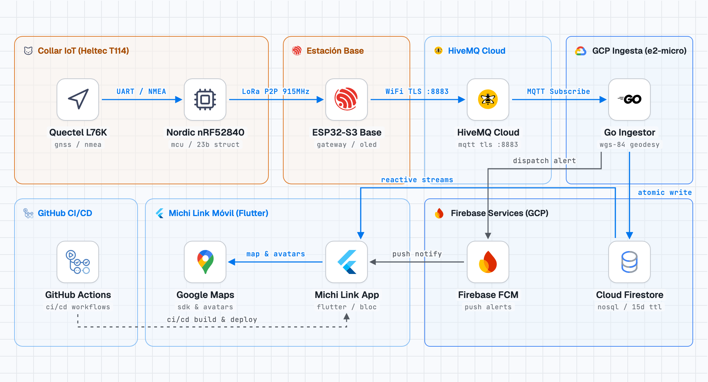
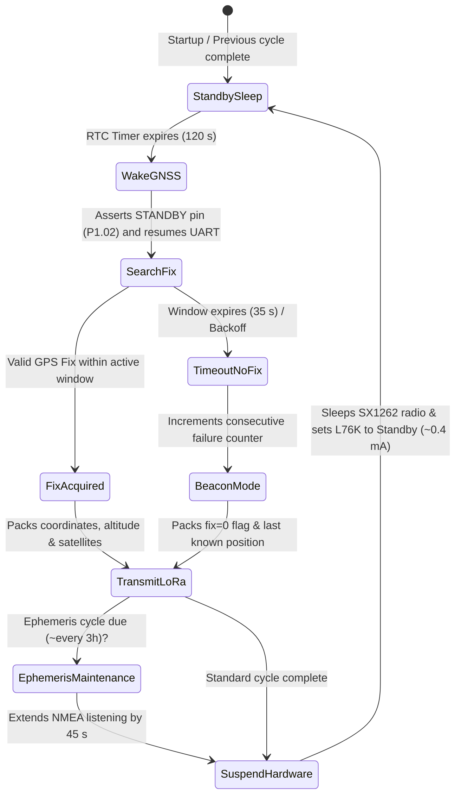
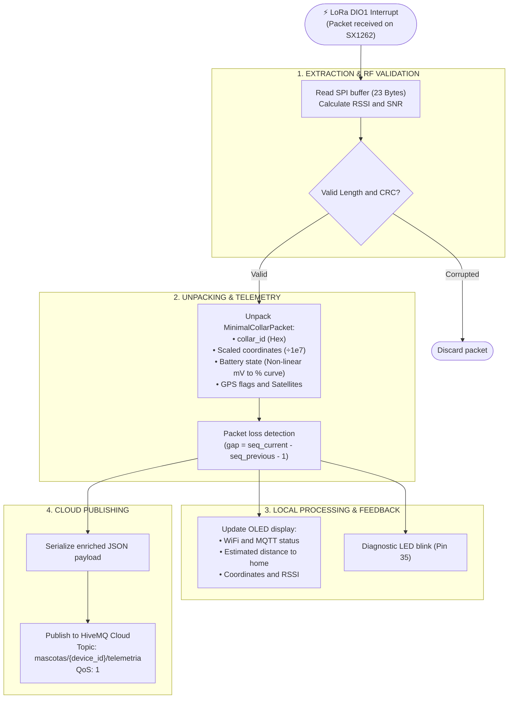
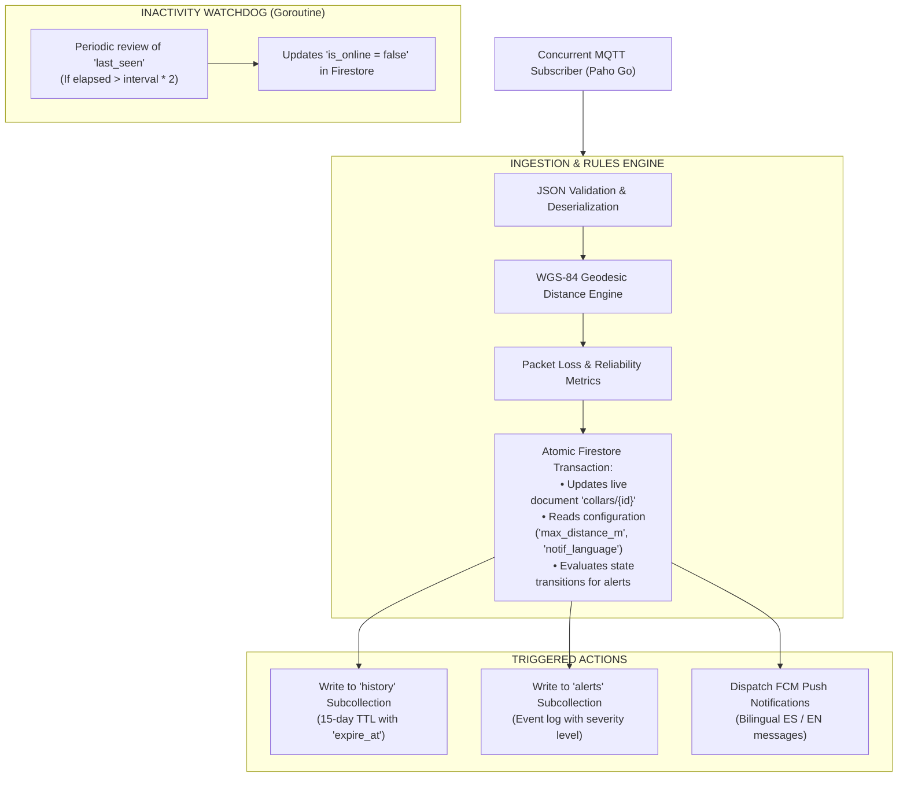

# Michi Link

[](https://flutter.dev)
[](https://dart.dev)
[](https://go.dev)
[](https://www.espressif.com/)
[](https://www.semtech.com/lora)
[](https://firebase.google.com/)
[](LICENSE)

**Michi Link** is a comprehensive IoT ecosystem designed for continuous satellite tracking, telemetry monitoring, and safety of domestic pets (specifically cats) in suburban and urban environments. The system combines an ultra-low-power long-range **LoRa P2P (915 MHz)** radio link on the pet's collar, an **ESP32-S3** relay base station connected via WiFi, a **TLS-encrypted MQTT** messaging broker, a high-throughput concurrent **Go** ingestion microservice hosted on Google Cloud Platform (GCP) with a WGS-84 geodesic engine and push notification dispatcher (**FCM**), and a cross-platform mobile client developed in **Flutter** following a Feature-First architecture.

---

## 📑 Table of Contents

1. [Global System Architecture](#-global-system-architecture)
   - [Interactive Architecture Diagram](#interactive-architecture-diagram)
   - [Detailed Layer Breakdown](#detailed-layer-breakdown)
   - [End-to-End System Flow](#end-to-end-system-flow)
2. [Quick Start](#-quick-start)
   - [Prerequisites](#1-prerequisites)
   - [Setup by Component](#2-setup-by-component)
3. [Unified Command Table](#-unified-command-table)
4. [Ecosystem Components](#-ecosystem-components)
   - [1. IoT Collar (Heltec T114 - nRF52840 + SX1262 + L76K)](#1-iot-collar-heltec-t114)
   - [2. Base Station (Heltec WiFi LoRa 32 V3 - ESP32-S3)](#2-base-station-heltec-wifi-lora-32-v3)
   - [3. Communication Protocol and RF Link](#3-communication-protocol-and-rf-link)
   - [4. Ingestion and Processing Backend in Go](#4-ingestion-and-processing-backend-in-go)
   - [5. Persistence and Data Model in Cloud Firestore](#5-persistence-and-data-model-in-cloud-firestore)
   - [6. Mobile Application in Flutter](#6-mobile-application-in-flutter)
5. [Architecture Decision Records (ADRs)](#-architecture-decision-records-adrs)
   - [ADR-001: LoRa P2P Radio Link vs. LoRaWAN Network](#adr-001-lora-p2p-radio-link-vs-lorawan-network)
   - [ADR-002: Compact Over-the-Air Binary Packet Format (23 Bytes)](#adr-002-compact-over-the-air-binary-packet-format-23-bytes)
   - [ADR-003: Go Ingestion Backend and Event Engine on GCP e2-micro](#adr-003-go-ingestion-backend-and-event-engine-on-gcp-e2-micro)
   - [ADR-004: Hybrid Persistence Model in Firestore with 15-Day TTL](#adr-004-hybrid-persistence-model-in-firestore-with-15-day-ttl)
   - [ADR-005: Feature-First Architecture with BLoC/Cubit and GetIt in Flutter](#adr-005-feature-first-architecture-with-bloccubit-and-getit-in-flutter)
   - [ADR-006: Server-Side WGS-84 Geodesy and Multilingual Push Notifications with FCM](#adr-006-server-side-wgs-84-geodesy-and-multilingual-push-notifications-with-fcm)
6. [Project Directory Structure](#-project-directory-structure)
7. [Testing and Code Quality](#-testing-and-code-quality)
8. [License](#-license)

---

## 🏛️ Global System Architecture

### Interactive Architecture Diagram

<p align="center">
  <a href="https://stacks.caru.moe/s/QTocIhHVgN" target="_blank" rel="noopener noreferrer">
    <picture>
      <source media="(prefers-color-scheme: dark)" srcset="docs/architecture/michi-link-architecture-dark.png">
      
    </picture>
  </a>
</p>

> [!NOTE]
> An interactive version of this architecture diagram with vector brand logos, hover interactions, and full topology inspection is published at [**stacks.caru.moe/s/QTocIhHVgN**](https://stacks.caru.moe/s/QTocIhHVgN).

### Detailed Layer Breakdown

#### 1. 📡 Physical IoT & Field Hardware Layer
- **Collar IoT Node (`Heltec T114`)**:
  - **Quectel L76K GNSS Receiver**: Periodic reading of NMEA sentences (latitude, longitude, altitude, and active satellites).
  - **Nordic nRF52840 MCU (ARM Cortex-M4F)**: Ultra-low-power management, 23-byte compact binary packing ([ADR-002](#adr-002-compact-over-the-air-binary-packet-format-23-bytes)), hardware-level UART sleep, and exponential backoff during indoor satellite loss.
  - **Semtech SX1262 LoRa TX**: 915 MHz Point-to-Point (P2P) transmission (`SF7`, `BW 125 kHz`, `CR 4/5`, `+22 dBm`) achieving 200 m to 1 km in urban terrain with ~60 ms Time-on-Air (ToA).
- **Home Base Station (`Heltec WiFi LoRa 32 V3`)**:
  - **ESP32-S3 Dual Core MCU**: Unpacks raw binary frames, verifies CRC integrity, enriches telemetry with NTP timestamps, link metrics (RSSI, SNR), and sequence loss calculations.
  - **SSD1306 0.96" OLED Display**: Real-time visual diagnostic of WiFi status, MQTT broker connection, distance to home, and packet counts.
  - **WiFi 802.11 b/g/n Stack**: Secure TLS-encrypted MQTT client publishing structured JSON payloads.

#### 2. ☁️ Cloud Messaging Layer
- **HiveMQ Cloud**:
  - Fully-managed MQTT broker with TLS/SSL encryption on port `8883`.
  - Topics: `mascotas/+/telemetria` (periodic telemetry stream) and `mascotas/+/status` (LWT-backed connection presence).

#### 3. ⚙️ Ingestion & Processing Layer (GCP)
- **Go Ingestion Microservice (`backend_suscriptor`)**:
  - Deployed as a continuous systemd daemon (`michi-link.service`) on a **Google Cloud Platform (Compute Engine `e2-micro`)** VM instance.
  - **WGS-84 Geodesic Engine**: Calculates exact distance between the collar and the home base coordinates using ellipsoidal geodesy (`a = 6378137.0 m`, `f = 1/298.257223563`).
  - **Atomic Transition Engine**: Compares incoming states against persisted Firestore documents in atomic transactions to guarantee push alerts trigger only on genuine state changes (preventing alert spam).
  - **Inactivity Watchdog**: Goroutine monitoring `last_seen` timestamps and flagging lost connectivity when frames exceed thresholds.

#### 4. 🔥 Persistence & Notifications Layer (Firebase / GCP)
- **Cloud Firestore**:
  - Optimized for the Firebase Spark Plan (~720 daily writes per collar, well below the 20,000 free daily limit).
  - Primary collection `collars/{id}` storing live state, battery curve percentage, active geofence radius, and configuration.
  - Subcollections with **15-Day Time-To-Live (TTL)** policies (`expire_at`): `history/` (breadcrumb trajectory samples) and `alerts/` (chronological security incident logs).
- **Firebase Cloud Messaging (FCM)**:
  - Severity-based notification channels on Android and iOS: `michi_critical_channel`, `michi_warning_channel`, and `michi_info_channel`.
  - Automatic bilingual message dispatching (Spanish / English) tailored to the collar's stored language preference.

#### 5. 📱 Cross-Platform Mobile Client (Flutter)
- **Michi Link Mobile (`michi_link_mobile`)**:
  - Structured using **Feature-First Clean Architecture** with **BLoC / Cubit** for predictable unidirectional state management and **GetIt** for service location.
  - Styled with **Material 3 Expressive** design system (`expressive_kit`) with user-configurable dynamic seed colors.
  - Direct reactive Firestore streams (`snapshots()`) for live telemetry and map updates without polling overhead.
  - **Google Maps SDK**: Custom in-memory canvas rendering dynamic SVG cat avatars across 10 breeds, bounded by interactive geofence radius circles.

#### 6. 🚀 CI/CD & Automation
- **GitHub Actions**:
  - Automated continuous integration and deployment pipelines (`mobile-beta.yaml`, `mobile-prod.yaml`) executing static analysis, testing, and automated release packaging.

---

### End-to-End System Flow

```mermaid
flowchart TB
    %% IOT / HARDWARE LAYER
    subgraph IOT ["📡 1. IOT / HARDWARE LAYER"]
        direction LR
        subgraph COLLAR ["COLLAR T114 (Pet)"]
            direction TB
            C1["Quectel L76K GNSS\n(NMEA readings: Lat, Lon, Alt)"]
            C2["Nordic nRF52840 MCU\n• Packs 23B Binary Struct\n• Power management & backoff"]
            C3["Semtech SX1262 LoRa\n(TX 915 MHz, SF7, +22 dBm)"]
            C1 --> C2 --> C3
        end

        subgraph BASE ["BASE STATION (Home)"]
            direction TB
            B1["Semtech SX1262 LoRa\n(RX 915 MHz, DIO1 Interrupt)"]
            B2["ESP32-S3 Dual Core\n• Binary unpacking\n• Telemetry enrichment (NTP, RSSI, SNR)\n• SSD1306 128x64 OLED display"]
            B3["WiFi 802.11 b/g/n Stack\n(Secure TLS Client)"]
            B1 --> B2 --> B3
        end

        C3 -->|"LoRa P2P Radio Link\n(~200 m - 1 km urban)"| B1
    end

    %% CLOUD MESSAGING
    subgraph BROKER_ZONE ["☁️ 2. CLOUD MESSAGING"]
        BROKER["HiveMQ Cloud (MQTT Broker)\n• Port: 8883 (TLS/SSL)\n• Telemetry Topic: mascotas/+/telemetria\n• Status Topic: mascotas/+/status"]
    end

    %% GCP BACKEND
    subgraph BACKEND ["⚙️ 3. INGESTION & PROCESSING (GCP e2-micro)"]
        direction TB
        BE_GO["Go Ingestion Service\n• Concurrent Paho MQTT subscriber\n• WGS-84 Geodesic Engine (Vincenty/Haversine)\n• Dynamic geofencing & anomaly detection\n• Inactivity & disconnection watchdog"]
    end

    %% PERSISTENCE AND NOTIFICATIONS
    subgraph GOOGLE_SERVICES ["🔥 4. PERSISTENCE & NOTIFICATIONS"]
        direction LR
        DB[("Cloud Firestore\n• Live doc: collars/{id}\n• Subcollection: history (15d TTL)\n• Subcollection: alerts (15d TTL)")]
        FCM["Firebase Cloud Messaging (FCM)\nPush notifications in Spanish & English"]
    end

    %% MOBILE CLIENTS
    subgraph CLIENTES ["👥 5. END USERS (Flutter Mobile)"]
        direction LR
        CLI_APP["📱 Flutter Mobile App\n• Google Maps with Breed Avatars\n• Reactive streaming via Firestore snapshots\n• Link quality, geofence & battery telemetry\n• Incident history & breadcrumb paths"]
    end

    %% LAYER CONNECTIONS
    B3 -->|"Publishes JSON via MQTT over TLS"| BROKER
    BROKER -->|"Continuous event subscription"| BE_GO

    BE_GO -->|"Atomic transactions with TTL"| DB
    BE_GO -->|"Dispatches critical push alerts"| FCM

    DB -.->|"Reactive real-time stream"| CLI_APP
    FCM -->|"Push notifications to device"| CLI_APP
```



---

## 🚀 Quick Start

### 1. Prerequisites

- **Firmware**: [Arduino IDE 2.x](https://www.arduino.cc/en/software) or [PlatformIO](https://platformio.org/).
  - Board support for Heltec ESP32 (`v3.0.0+`) and Nordic nRF52 (`Adafruit nRF52 Board Support`).
  - Libraries: `RadioLib` (v6.6+), `TinyGPSPlus`, `PubSubClient`, `ArduinoJson` (v7+), `Adafruit_SSD1306`, `Adafruit_GFX`.
- **Backend**: [Go SDK](https://go.dev/dl/) version `>= 1.22.0`.
  - Google Cloud CLI (`gcloud`) authenticated with Application Default Credentials (ADC).
- **Mobile**: [Flutter SDK](https://flutter.dev/docs/get-started/install) `>= 3.47.0` and [Dart SDK](https://dart.dev/get-dart) `>= 3.12.0 < 4.0.0`.
  - Configured Android Studio or Xcode environment.
  - Valid API keys for Google Maps SDK and downloaded `google-services.json` (Android) / `GoogleService-Info.plist` (iOS).

---

### 2. Setup by Component

#### A. Collar Firmware (Heltec T114)
1. Connect the Heltec T114 board via USB-C.
2. Open sketch [`firmware/collar_t114/collar_t114.ino`](firmware/collar_t114/collar_t114.ino).
3. Review node settings in [`firmware/collar_t114/config.h`](firmware/collar_t114/config.h) (`COLLAR_ID`, 915 MHz frequency parameters).
4. Select the target board and compile/flash the firmware.

#### B. Base Station Firmware (ESP32-S3)
1. Connect the Heltec WiFi LoRa 32 V3 board via USB-C.
2. Open [`firmware/base_esp32/base_esp32.ino`](firmware/base_esp32/base_esp32.ino).
3. Configure WiFi network credentials and HiveMQ Cloud broker settings (`WIFI_SSID`, `WIFI_PASSWORD`, `MQTT_BROKER`, `MQTT_USER`, `MQTT_PASS`).
4. Flash the firmware. The OLED display will report WiFi and MQTT connectivity status, as well as incoming LoRa packets.

#### C. Ingestion Backend (Go)
1. Navigate to the backend directory:
   ```bash
   cd backend_suscriptor
   ```
2. Create and configure your environment variables in `.env`:
   ```ini
   GCP_PROJECT_ID=your-firebase-project-id
   HIVEMQ_BROKER=ssl://your-broker.s1.eu.hivemq.cloud:8883
   HIVEMQ_USER=your-mqtt-username
   HIVEMQ_PASS=your-mqtt-password
   COLLAR_INTERVAL_SEC=120
   ```
3. Fetch dependencies and run in local mode:
   ```bash
   go mod tidy
   go run ./cmd/ingester
   ```
4. To run the telemetry simulator (local testing without physical hardware):
   ```bash
   go run ./cmd/simulator
   ```

#### D. Mobile Application (Flutter)
1. Navigate to the mobile app directory:
   ```bash
   cd michi_link_mobile
   ```
2. Install dependencies and generate localization code:
   ```bash
   flutter pub get
   flutter gen-l10n
   ```
3. Run on an emulator or physical device:
   ```bash
   flutter run
   ```

---

## 🛠️ Unified Command Table

| Environment / Module | Command | Description |
| :--- | :--- | :--- |
| **Backend (Go)** | `go test ./... -v` | Executes the complete backend unit test suite. |
| **Backend (Go)** | `go test ./cmd/ingester -cover` | Measures code coverage for the ingestion service and geofencing engine. |
| **Backend (Go)** | `go build -ldflags="-s -w" -o backend_suscriptor ./cmd/ingester` | Compiles optimized production binary for Linux/GCP. |
| **Backend (Go)** | `./deploy.sh` | Automated systemd deployment script on GCP Compute Engine VM. |
| **Backend (Go)** | `go run ./cmd/simulator` | Launches synthetic telemetry generator for MQTT load and integration testing. |
| **Mobile (Flutter)** | `flutter pub get` | Resolves and downloads Flutter package dependencies. |
| **Mobile (Flutter)** | `flutter gen-l10n` | Regenerates typed localization classes from `.arb` translation files. |
| **Mobile (Flutter)** | `flutter test` | Runs unit and widget test suites in Flutter. |
| **Mobile (Flutter)** | `flutter test --coverage` | Executes tests and generates LCOV coverage report at `coverage/lcov.info`. |
| **Mobile (Flutter)** | `flutter analyze` | Runs static code analysis (`very_good_analysis` and `bloc_lint`). |
| **Mobile (Flutter)** | `dart fix --apply` | Automatically applies recommended linter and formatting fixes. |
| **Mobile (Flutter)** | `flutter run -d chrome` | Launches app in web browser for rapid UI and layout inspection. |
| **Mobile (Flutter)** | `flutter build apk --release` | Builds optimized APK installer for Android devices. |
| **Mobile (Flutter)** | `flutter build appbundle --release` | Compiles release Android App Bundle (AAB) for Google Play Store. |

---

## 🧩 Ecosystem Components

### 1. IoT Collar (Heltec T114)

The collar node is built on the **Nordic nRF52840** microcontroller (ARM Cortex-M4 with FPU) paired with a **Semtech SX1262** transceiver and a **Quectel L76K** GNSS receiver.



- **Advanced Power Management**:
  - The L76K GNSS module is switched into standby mode via hardware using the physical `STANDBY` pin (P1.02), eliminating vulnerabilities where chips ignore software NMEA commands.
  - Clean UART suspension (`gpsUartSuspend`) precharges the GPIO latch `HIGH` before powering down the peripheral, preventing the spurious falling edge that would accidentally wake the receiver.
  - **Indoor Backoff Algorithm**: When the pet enters an indoor enclosure with no satellite coverage, the firmware detects consecutive acquisition timeouts and extends backoff intervals up to 60 minutes between prolonged search attempts, protecting battery life.
- **LiPo Cell Protection**:
  - Calibrated ADC reading on pin `PIN_BAT_ADC` via a transistor-controlled resistive divider (`PIN_BAT_ADC_CTL`).
  - Critical voltage threshold at `3350 mV`: after 3 consecutive readings below this level, the collar enters indefinite sleep to prevent irreversible damage to the LiPo cell.

---

### 2. Base Station (Heltec WiFi LoRa 32 V3)

The base station is stationary inside the owner's home and is powered by an **ESP32-S3** with a 0.96-inch monochrome OLED display (SSD1306).



- **Non-Linear Battery Curve**: Translates millivolts into percentage using a piecewise linear algorithm calibrated to lithium-ion discharge chemistry (from 4160 mV for 100% down to 3000 mV for cutoff).
- **Packet Gap Metrics**: Tracks missing sequences (`packets_lost_gap`) while handling 16-bit integer rollover safely.

---

### 3. Communication Protocol and RF Link

#### A. Compact Over-the-Air Binary Packet (23 Bytes)

To minimize Time-on-Air (ToA) and maximize RF link margin, the collar transmits a packed C++ binary structure:

```cpp
struct __attribute__((packed)) MinimalCollarPacket {
  uint64_t collar_id;  // 8 bytes: Unique 16-character hexadecimal ID
  uint16_t seq;        // 2 bytes: Incremental sequence counter
  int32_t lat_scaled;  // 4 bytes: Latitude scaled to 7 decimals (lat * 10,000,000)
  int32_t lon_scaled;  // 4 bytes: Longitude scaled to 7 decimals (lon * 10,000,000)
  int16_t alt_m;       // 2 bytes: Altitude above sea level in meters (-32768 to 32767)
  uint16_t battery_mv; // 2 bytes: Battery voltage in millivolts (e.g. 3980 = 3.98V)
  uint8_t gps_flags;   // 1 byte:  Bit 7: Valid Fix (1/0) | Bits 0..6: Satellite count
};
```

#### B. Radio Frequency Parameters (SX1262)

| Parameter | Configured Value | Technical Rationale |
| :--- | :--- | :--- |
| **Center Frequency** | `915.0 MHz` | License-free ISM band for Region 2 (Americas). |
| **Bandwidth (BW)** | `125.0 kHz` | Optimal balance between receiver sensitivity and modulation throughput. |
| **Spreading Factor (SF)** | `SF7` | Ultra-short Time-on-Air (~60 ms per burst), minimizing RF energy drain. |
| **Coding Rate (CR)** | `4/5` | Forward Error Correction (FEC) with low packet overhead. |
| **Transmission Power** | `+22 dBm` | Maximum amplifier output on the SX1262 to penetrate urban obstructions. |
| **TCXO Voltage** | `1.8 V` | Powers the temperature-compensated crystal oscillator on Heltec T114 (DIO3). |

#### C. MQTT Topic Hierarchy (HiveMQ Cloud Broker)

| Topic | Direction | Event Type | Primary Content |
| :--- | :--- | :--- | :--- |
| `mascotas/{pet_id}/telemetria` | Base → Cloud | Periodic (120 s) | Comprehensive JSON payload with coordinates, battery, RSSI, SNR, distance, and loss gap. |
| `mascotas/{pet_id}/status` | Base → Cloud | Link Presence | Connection status: `"online"` at base startup and `"offline"` via Last Will and Testament (LWT). |
| `mascotas/{pet_id}/alertas` | Server → Cloud | Immediate | Real-time critical security events (geofence breach, critical battery, beacon mode). |
| `mascotas/{pet_id}/comandos` | App → Base | On Demand | Remote downlink commands (e.g., enable rapid tracking mode with 15 s intervals). |

---

### 4. Ingestion and Processing Backend in Go

The [`backend_suscriptor`](backend_suscriptor) service runs as a concurrent daemon in Go on a Google Cloud Compute Engine `e2-micro` virtual machine.



- **WGS-84 Geodesic Engine**: Calculates exact surface distance along the standard WGS-84 reference ellipsoid (`a = 6378137.0 m`, `f = 1/298.257223563`), providing sub-meter accuracy between the pet's collar and home coordinates.
- **Spam-Free State Transitions**: Ingested telemetry is compared against the persisted Firestore document inside an atomic transaction. Push notifications are dispatched only during genuine state transitions (e.g., transition from inside to outside geofence, or normal to critical battery), preventing repeated notifications on every periodic frame.
- **Alert Types and Severity Levels**:
  - `GEOFENCE_BREACH` (`CRITICAL`): Pet exceeded the configured safe distance (`max_distance_m`).
  - `GEOFENCE_RECOVERY` (`INFO`): Pet returned inside the safe perimeter.
  - `BATTERY_CRITICAL` (`CRITICAL`): Battery percentage dropped below 10%.
  - `BATTERY_LOW` (`WARNING`): Battery percentage dropped below configured warning threshold (e.g., 20%).
  - `BATTERY_RECOVERY` (`INFO`): Battery level recovered following recharge.
  - `LORA_WEAK_SIGNAL` (`WARNING`): RF link signal dropped below `-115 dBm`.
  - `GPS_FIX_LOST` (`WARNING`): Collar lost GNSS satellite fix and transitioned to radio beacon mode.
  - `GPS_FIX_RECOVERED` (`INFO`): Satellite lock restored.

---

### 5. Persistence and Data Model in Cloud Firestore

The data schema is optimized to operate **100% within Firebase Spark Plan (Free Tier)** limits:

```text
collars/ (Primary Collection)
  └── {collar_id} (Document: Live State & Configuration)
        ├── device_id: "COLLAR_01"
        ├── name: "Michi"
        ├── is_online: true
        ├── last_seen: Timestamp
        ├── seq: 142
        ├── packets_received: 1250
        ├── packets_lost: 12
        ├── packet_loss_pct: 0.95
        ├── has_active_alert: false
        ├── coords: { lat: -8.0666, lon: -79.0628, alt_m: 25.0 }
        ├── base_coords: { lat: -8.0670, lon: -79.0630 }
        ├── status: { battery_v: 3.98, battery_pct: 88, gps_fix: true, sats: 8 }
        ├── radio: { rssi: -68, snr: 9.5, distance_home_m: 48.2, packets_lost_gap: 0 }
        ├── config:
        │     ├── max_distance_m: 150.0
        │     ├── min_battery_pct: 10
        │     ├── require_gps_fix: true
        │     └── notif_language: "en"
        ├── last_alert: { type: "GEOFENCE_BREACH", severity: "CRITICAL", timestamp: Timestamp }
        │
        ├── history/ (Subcollection: Historical Telemetry Samples)
        │     └── {auto_id}
        │           ├── timestamp: Timestamp
        │           ├── expire_at: Timestamp  <-- [15-day TTL active in Firestore]
        │           ├── seq: 142
        │           ├── coords: { lat: -8.0666, lon: -79.0628, alt_m: 25.0 }
        │           ├── status: { battery_v: 3.98, battery_pct: 88, gps_fix: true, sats: 8 }
        │           └── radio: { rssi: -68, snr: 9.5, distance_home_m: 48.2, packets_lost_gap: 0 }
        │
        └── alerts/ (Subcollection: Security Incident History)
              └── {auto_id}
                    ├── timestamp: Timestamp
                    ├── expire_at: Timestamp  <-- [15-day TTL active in Firestore]
                    ├── type: "GEOFENCE_BREACH"
                    ├── severity: "CRITICAL"
                    └── value: 168.5
```

- **Spark Plan Budget**: At one packet every 120 seconds, a collar produces ~720 daily writes (~3.6% of Firestore's 20,000 free daily writes).
- **TTL Policies**: The `expire_at` field (`now + 15 days`) allows Firestore to automatically purge expired records with zero additional read or write costs.

---

### 6. Mobile Application in Flutter

The mobile application [`michi_link_mobile`](michi_link_mobile) is structured following the **Feature-First** pattern with clean architecture across three distinct layers:

```text
lib/
├── app/                  # Core and global configuration
│   ├── cubit/            # Global application state (language, light/dark theme, seed color)
│   ├── global/           # GoRouter routes, GetIt service locator, constants & themes
│   ├── models/           # Immutable domain entities (CollarModel, AlertRecord, etc.)
│   ├── repositories/     # Repository contracts and implementations (Firestore, Hive, Mocks)
│   ├── services/         # Infrastructure services (Crashlytics, Performance, Analytics)
│   └── view/             # Base UI wrappers (AppPage, AppView)
├── collars/              # Feature: Collar pairing, editing, and configuration
├── history/              # Feature: Breadcrumb tracking, polyline rendering & timeline playback
├── home/                 # Feature: Main dashboard (Google Maps, telemetry panel, geofence ring)
├── l10n/                 # Feature: ARB translation templates and bilingual generator
├── notifications/        # Feature: Notification center and incident event log
├── settings/             # Feature: User preferences, language selection, dynamic color schemes
├── bootstrap.dart        # Global BLoC observer setup and error boundary initialization
├── firebase_options.dart # Auto-generated Firebase client credentials
└── main.dart             # Application entrypoint
```

#### Key UI/UX Highlights
- **Dynamic Google Maps Markers**: In-memory canvas generator rendering custom SVG cat avatars for 10 distinct breeds, surrounded by live geofence radius indicators.
- **Dual Environment Architecture**: Seamless switching between `Environment.mock` (isolated offline demo mode with synthetic data) and `Environment.prod` (live Firebase & Firestore connectivity).
- **Material 3 Expressive System**: Powered by `expressive_kit`, dynamically computing harmonic color schemes from a user-selected seed color.

---

## 📐 Architecture Decision Records (ADRs)

Architecture Decision Records document the context, technical constraints, evaluated alternatives, and consequences of key architectural choices in Michi Link.

---

### ADR-001: LoRa P2P Radio Link vs. LoRaWAN Network

- **Status**: Accepted
- **Date**: 2026-10-24

#### Context
Tracking domestic cats wandering within 200 meters to 1 kilometer of their home requires a long-range, battery-efficient RF link with zero recurring cellular subscription costs. We evaluated standard LoRaWAN (public or private gateways via The Things Network - TTN) against a Point-to-Point (P2P) LoRa link connecting the collar directly to a dedicated home base station.

#### Decision
Adopt a **915 MHz LoRa P2P architecture** using direct SX1262 modulation with tuned parameters (`SF7`, `BW 125 kHz`, `CR 4/5`, `+22 dBm` output power).

#### Alternatives Evaluated
1. **LoRaWAN (The Things Network / Helium)**:
   - *Pros*: Standardized ecosystem, OTAA session keys.
   - *Cons*: Sparse, unreliable public gateway coverage in residential suburban zones; mandatory LoRaWAN frame headers (adding ≥13 bytes overhead per packet); required RX windows that drain battery on the micro-node.
   - *Reason for Rejection*: The pet stays near the owner's home where the owner maintains a base station. LoRaWAN introduced unnecessary complexity and increased Time-on-Air (ToA).
2. **Cellular NB-IoT / LTE-M**:
   - *Pros*: Theoretically unlimited geographic range.
   - *Cons*: Modems are too bulky and heavy for a cat's collar; peak current draws (>150 mA) demand heavy batteries; requires monthly SIM data subscriptions.
   - *Reason for Rejection*: Impractical for small domestic pets due to weight and size constraints.

#### Consequences
- **Positive**: Total operational independence with zero monthly subscription fees; minimal Time-on-Air (~60 ms); low-cost hardware.
- **Trade-offs**: Range is bounded by home base station RF coverage (~1 km line-of-sight). The beacon mode mitigation was designed to handle temporary out-of-range events.

---

### ADR-002: Compact Over-the-Air Binary Packet Format (23 Bytes)

- **Status**: Accepted
- **Date**: 2026-10-24

#### Context
In LoRa modulations, every additional transmitted byte increases Time-on-Air (ToA), amplifying energy consumption and the probability of on-air packet collisions. The radio packet needed to convey collar identity, sequence numbers, latitude, longitude, altitude, battery voltage, and satellite fix metadata.

#### Decision
Define an aligned, packed C++ binary structure (`__attribute__((packed))`) of exactly **23 bytes** named `MinimalCollarPacket`.

#### Alternatives Evaluated
1. **JSON Over-the-Air**:
   - *Pros*: Human-readable, trivial debugging in serial monitors.
   - *Cons*: Equivalent JSON requires 110 to 160 bytes. This multiplies ToA by ~5x, reducing battery lifespan from 7 days down to under 48 hours.
   - *Reason for Rejection*: Grossly inefficient for battery-constrained LoRa transmitters.
2. **Protocol Buffers (Protobuf) / CBOR**:
   - *Pros*: Standardized binary serialization.
   - *Cons*: Tag overhead per field and additional library footprint on the resource-constrained microcontroller.
   - *Reason for Rejection*: For a fixed, immutable schema, a packed C struct has zero wire overhead and requires no third-party serialization libraries.

#### Consequences
- **Positive**: Maximum compression ratio; transmissions complete in under 65 ms; minimal current consumption per wake cycle.
- **Trade-offs**: Requires identical struct definitions and matching little-endian byte ordering on both the transmitter (nRF52840) and receiver (ESP32-S3).

---

### ADR-003: Go Ingestion Backend and Event Engine on GCP e2-micro

- **Status**: Accepted
- **Date**: 2026-10-24

#### Context
MQTT messages from the base station must be consumed without loss, parsed immediately, evaluated against geofencing rules, written to Firestore, and dispatched as push notifications. A backend compute platform was needed that remains continuously active 24/7 at zero infrastructure cost.

#### Decision
Develop the ingestion backend in **Go** using `paho.mqtt.golang` and run it as a systemd service on a **Google Cloud Compute Engine `e2-micro` VM** (covered under the GCP Always Free Tier in `us-central1`, `us-east1`, or `us-west1`).

#### Alternatives Evaluated
1. **Serverless (Cloud Functions / Cloud Run)**:
   - *Pros*: Managed auto-scaling without server administration.
   - *Cons*: HiveMQ Cloud requires a persistent MQTT client connection with continuous KeepAlive pings. Triggering Cloud Functions via HTTP webhooks introduces cold start latency and per-invocation request charges.
   - *Reason for Rejection*: MQTT ingestion requires a persistent connection daemon.
2. **Node.js / Python Backend**:
   - *Pros*: Fast initial prototyping.
   - *Cons*: Higher baseline memory usage (120-250 MB). The `e2-micro` instance only offers 1 GB of shared RAM.
   - *Reason for Rejection*: Go compiles to a native binary using less than 18 MB of RAM in steady state with lightweight goroutine concurrency.

#### Consequences
- **Positive**: Near-zero CPU utilization (<1%); RAM consumption under 25 MB; zero monthly GCP cost within the Free Tier; sub-second ingestion response times.
- **Trade-offs**: Requires deployment script automation ([`backend_suscriptor/deploy.sh`](backend_suscriptor/deploy.sh)) and systemd service supervision.

---

### ADR-004: Hybrid Persistence Model in Firestore with 15-Day TTL

- **Status**: Accepted
- **Date**: 2026-10-24

#### Context
The mobile app requires real-time reactive synchronization of the pet's latest status, as well as access to historical breadcrumb paths for the past several days and an incident log. Retaining all raw points indefinitely would eventually breach Firestore's 1 GB free storage tier.

#### Decision
Implement a hybrid data model in **Cloud Firestore**:
1. A root document in `collars/{id}` storing the current live state (overwritten atomically on every cycle).
2. Two subcollections: `history/` (breadcrumb samples) and `alerts/` (security events), both stamped with `expire_at = Timestamp.now() + 15 days` and managed by automatic Firebase TTL policies.

#### Alternatives Evaluated
1. **Historical Array inside the Primary Collar Document**:
   - *Pros*: Single read operation retrieves everything.
   - *Cons*: Firestore enforces a strict 1 MB maximum document size limit. An incremental array would violate this limit within weeks.
   - *Reason for Rejection*: Violates Firestore scalability guidelines.
2. **External Relational Database (PostgreSQL / Supabase)**:
   - *Pros*: Advanced relational querying.
   - *Cons*: Requires separate infrastructure management and loses native reactive Flutter snapshot streams (`snapshots()`).
   - *Reason for Rejection*: Firestore delivers out-of-the-box live synchronization with Flutter.

#### Consequences
- **Positive**: Mobile app listens only to the live root document for the primary dashboard (minimizing read operations); historical samples are loaded on-demand; automatic TTL cleanup incurs zero delete charges.
- **Trade-offs**: Historical route retention is bounded to a 15-day rolling window.

---

### ADR-005: Feature-First Architecture with BLoC/Cubit and GetIt in Flutter

- **Status**: Accepted
- **Date**: 2026-10-24

#### Context
The mobile client coordinates GPS hardware, mapping SDKs, Firestore reactive streams, local offline Hive caching, and multiple UI states (geofences, telemetry, alerts, settings). A clean, decoupled, and highly testable architecture was required, with frictionless switching between production and offline demo environments.

#### Decision
Adopt a **Feature-First Architecture** combining **BLoC / Cubit** for unidirectional reactive state management and **GetIt (Service Locator)** with an abstract service factory (`ServiceFactory`) for dependency injection across environments (`Environment.mock` vs `Environment.prod`).

#### Alternatives Evaluated
1. **Layer-First Architecture (data-domain-presentation)**:
   - *Pros*: Familiar in small applications.
   - *Cons*: Impairs codebase navigation as features expand; modifications to a single screen require jumping across distant directories.
   - *Reason for Rejection*: Feature-First encapsulates related code by domain, maximizing maintainability.
2. **State Management via Riverpod or Provider**:
   - *Pros*: Less initial boilerplate.
   - *Cons*: BLoC delivers total predictability for complex event streams, integrated tracing via `BlocObserver`, and first-class testing ergonomics via `bloc_test`.
   - *Reason for Rejection*: Industry standard aligned with Very Good Ventures architecture principles.

#### Consequences
- **Positive**: Streamlined unit testing without widget mounting; instantaneous switching to mock mode for UI tests; modular code organization.
- **Trade-offs**: Requires declaring abstract repository contracts for every infrastructure service.

---

### ADR-006: Server-Side WGS-84 Geodesy and Multilingual Push Notifications with FCM

- **Status**: Accepted
- **Date**: 2026-10-24

#### Context
When a pet escapes the safe perimeter or battery drops to critical levels, the owner must receive an immediate push notification on their phone, even if the application is killed or in the background. Distance calculations could not be delegated to the phone (which might be suspended) nor computed as a flat Euclidean approximation on the base station (prone to distortion).

#### Decision
Perform geodesic distance calculations on the Go backend using the **WGS-84 reference ellipsoid** formula and dispatch high-priority push notifications through **Firebase Cloud Messaging (FCM)** with server-side bilingual support (Spanish and English) based on the collar's configuration.

#### Alternatives Evaluated
1. **Geofencing on the ESP32 Base Station**:
   - *Pros*: Immediate trigger without cloud backend dependency.
   - *Cons*: The ESP32 does not hold FCM service account credentials for push dispatch and lacks user language preferences.
   - *Reason for Rejection*: Base stations must remain lightweight, agnostic hardware relays.
2. **Geofencing on the Client Mobile Phone**:
   - *Pros*: Simple to implement using device location plugins.
   - *Cons*: If the OS terminates or throttles the app in the background, escape alerts will fail to reach the user.
   - *Reason for Rejection*: Unacceptable reliability hazard for a pet safety system.

#### Consequences
- **Positive**: Sub-meter geofence breach detection accuracy; absolute push notification delivery independent of device state; centralized internationalization.
- **Trade-offs**: Requires reliable outbound internet connectivity from the Go VM on GCP to FCM endpoints.

---

## 📂 Project Directory Structure

```text
Michi_Link/
├── .github/                      # CI/CD workflows (GitHub Actions) & cspell rules
│   └── workflows/
│         ├── mobile-beta.yaml    # Test, lint, and Google Play Store Beta release pipeline
│         └── mobile-prod.yaml    # Production release pipeline
├── backend_suscriptor/           # Go Ingestion Microservice (GCP e2-micro VM)
│   ├── cmd/
│   │   ├── ingester/             # Main daemon: MQTT subscriber, WGS-84, Firestore & FCM
│   │   │   ├── main.go
│   │   │   └── main_test.go      # Integration and geofence test suite
│   │   └── simulator/            # Synthetic telemetry and load testing tool
│   │       ├── main.go
│   │       └── main_test.go
│   ├── internal/
│   │   └── models/               # Shared models, JSON payloads, and Firestore schema types
│   ├── deploy.sh                 # Compilation and systemd automated deployment script
│   ├── go.mod                    # Go module and dependencies
│   └── go.sum
├── docs/                         # System documentation and architecture assets
│   └── architecture/             # Architecture diagrams generated with stack-diagram
│         ├── michi-link-architecture.png
│         ├── michi-link-architecture-dark.png
│         └── michi-link-architecture.html
├── firmware/                     # Embedded C++ / Arduino source code
│   ├── base_esp32/               # Firmware for Heltec WiFi LoRa 32 V3 (ESP32-S3)
│   │   ├── base_esp32.ino        # LoRa reception, OLED display, WiFi and MQTT publication
│   │   └── packet.h              # 23-byte binary packet structure definition
│   └── collar_t114/              # Firmware for Heltec T114 (Nordic nRF52840)
│         ├── collar_t114.ino     # Power management, GNSS reading, and LoRa transmission
│         ├── config.h            # RF parameters, pin mappings, and timing windows
│         └── packet.h              # Identical MinimalCollarPacket binary layout
├── michi_link_mobile/            # Cross-platform Flutter mobile client
│   ├── android/                  # Native Android configuration, Gradle & manifests
│   ├── ios/                      # Native iOS configuration & Runner workspace
│   ├── assets/                   # Visual assets (icons, SVG breed avatars)
│   ├── lib/                      # Dart source code with Feature-First architecture
│   │   ├── app/                  # Core: global BLoC, themes, routes, repositories, services
│   │   ├── collars/              # Feature: Collar pairing, editing, and configuration
│   │   ├── history/              # Feature: Polyline breadcrumb mapping and route playback
│   │   ├── home/                 # Feature: Main dashboard with Google Maps and telemetry
│   │   ├── l10n/                 # Feature: ARB localization templates (English and Spanish)
│   │   ├── notifications/        # Feature: Notification center and incident event logs
│   │   ├── settings/             # Feature: User preferences, units, and dynamic themes
│   │   ├── bootstrap.dart        # Error boundary and BLoC observer initialization
│   │   └── main.dart             # Mobile app entrypoint
│   ├── test/                     # Unit and widget test suites with mocktail and bloc_test
│   ├── pubspec.yaml              # Flutter dependencies and metadata
│   └── l10n.yaml                 # Localization generator configuration
├── notification_sender/          # Local Node.js CLI tool for testing FCM push alerts
│   ├── index.js                  # Interactive and manual CLI for FCM topics and device tokens
│   ├── package.json
│   └── README.md
├── LICENSE                       # Open-source MIT License
└── README.md                     # Master project technical documentation
```

---

## 🧪 Testing and Code Quality

### 1. Backend in Go

The Go backend includes comprehensive unit and integration tests covering WGS-84 geodesic calculations, geofence state transitions, payload serialization, and disconnection watchdog routines:

```bash
cd backend_suscriptor
go test -v ./...
```

To measure code coverage:
```bash
go test -coverprofile=coverage.out ./cmd/ingester
go tool cover -func=coverage.out
```

### 2. Mobile Application in Flutter

The mobile application enforces strict code health standards using **Very Good Analysis** and **bloc_lint**:

```bash
cd michi_link_mobile

# 1. Static code analysis
flutter analyze

# 2. Execute unit and widget test suites
flutter test

# 3. Generate LCOV test coverage report
flutter test --coverage
```

---

## 📄 License

This project is licensed under the terms of the **MIT License**. See the [LICENSE](LICENSE) file for complete details.
